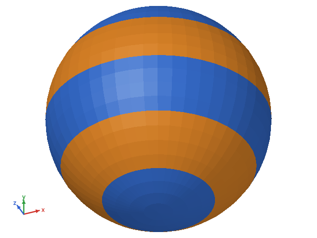
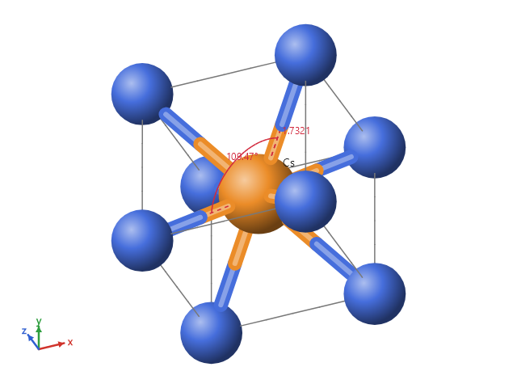
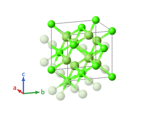
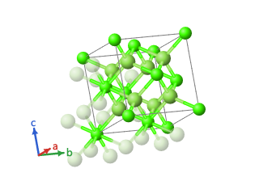
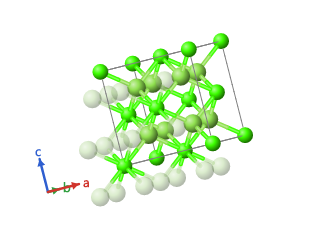
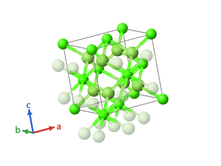
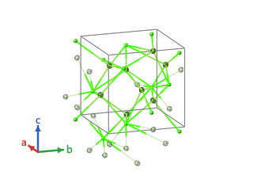
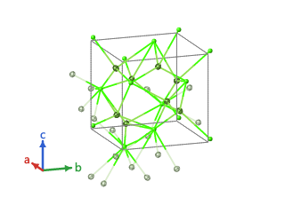
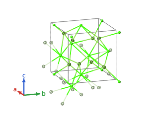

# Viewer3D

A small 3D viewer for [Avalonia](https://avaloniaui.net/) 12, painted by software through SkiaSharp. It shows
surfaces (closed spherical surfaces and height fields) and ball-and-stick scenes, with orbit, zoom and pan, a fixed
axis indicator, picking, and off-screen export to PNG.

It does not use OpenGL or any GPU API: frames are prepared on the CPU and painted as Skia triangles, circles and
lines. It looks and behaves the same with GPU or software rendering, and in `Avalonia.Headless`, which makes it easy
to test.

| Spherical surface | Balls and sticks |
|---|---|
|  |  |

## Packages

| Package | What it has |
|---|---|
| `Viewer3D` | Scene, camera, frame preparation, picking, axis indicator, color maps and surface builders. No UI and no graphics library: only `System.Numerics`. |
| `Viewer3D.Avalonia` | The `Viewer3DControl` for Avalonia 12, painted with SkiaSharp. |
| `Viewer3D.Crystal` | Optional crystal layer: a crystal structure turned into a scene, in ball and stick or space filling. References only `Viewer3D`. |

## Quick start

```csharp
using System.Numerics;
using Viewer3D;
using Viewer3D.Avalonia;

// A surface r(theta, phi) on a grid of N + 1 rows: one value at each pole, 2N values in between.
int n = 90;
double[][] radii = /* your grid */;
var map = new LevelColorMap(levels, colors);           // or new FuncColorMap(v => ...)
// The key light, from the upper left, shows the relief; the default light, at the eye, is flatter.
MeshItem surface = SurfaceBuilder.Spherical(radii, n, map: map, lighting: MeshLighting.KeyLight);

var viewer = new Viewer3DControl
{
    Scene = new Scene([surface]),
    // Optional: a lighter scene painted while the user drags or zooms.
    LowDetailScene = new Scene([SurfaceBuilder.Spherical(SurfaceBuilder.Decimate(radii, n, 3), n / 3, map: map, lighting: MeshLighting.KeyLight)]),
    AxisDirections = [new(Vector3.UnitX, "a"), new(Vector3.UnitY, "b"), new(Vector3.UnitZ, "c")],
};
viewer.Camera!.Frame(viewer.Scene);

byte[] png = viewer.RenderToPng(1600, 1200);
```

Scenes are lists of items: `MeshItem` (triangles with a color per vertex or per face), `SphereItem`, `RodItem` (a
stick drawn in two halves, each with the color of its end, cut where it enters the spheres), `LineItem` and
`LabelItem`. Each item has an `Id`, which picking reports back. A mesh is lit by a light at the eye
(`MeshLighting.Headlight`, the default) or by a key light from the upper left of the screen with a small highlight
(`MeshLighting.KeyLight`), which shows the relief of a surface seen head on; a weak fill light and a high ambient keep
the colors of the darker side.

## Interaction

| Gesture | Effect |
|---|---|
| Drag | Rotate |
| Right drag, or Shift and drag | Move |
| Wheel | Zoom at the pointer |
| Double click | Frame the scene |
| Arrow keys, `+` and `-` | Rotate and zoom |

The `Camera` raises `Changed` on every change, so two viewers that share one camera instance move together.
`ItemHovered` reports what is under the pointer, with the triangle and barycentric weights for meshes. `ItemClicked`
reports what was clicked (or the background) on a left click that did not turn into a drag.

A `SphereItem` with `Sectors` is painted as wedges from twelve o'clock, clockwise, each in its own color; what the
fractions leave of the turn stays empty, with the outline of the disc.

## Crystal layer

`Viewer3D.Crystal` builds the scene of a crystal structure. The layer is optional: `Viewer3D.Avalonia` does not
reference it.

| Ball and stick | Space filling |
|---|---|
|  |  |

```csharp
using Viewer3D.Crystal;

var cell = new CrystalCell(5.463, 5.463, 5.463, 90, 90, 90);       // angstrom and degrees
CrystalAtom[] atoms = [new("Ca1", "Ca", 0, 0, 0) { SiteIndex = 0 }, /* every position, one by one */];
CrystalBond[] bonds = [new(0, 4, LatticeShift.Zero), /* second atom translated by the shift */];
var structure = new CrystalStructure(cell, atoms, bonds);
// Bonds given around one atom per site are extended to the other atoms of the site.
structure = structure with { Bonds = CrystalBondExpansion.ExtendToEquivalentAtoms(structure) };

CrystalScene scene = new CrystalSceneBuilder().Build(structure, new CrystalSceneOptions
{
    Style = CrystalStyle.BallAndStick,          // or CrystalStyle.SpaceFilling
    RepeatA = 2, RepeatB = 2, RepeatC = 1,      // cells along each axis, up to the cost ceiling
});
viewer.Scene = scene.Scene;
viewer.AxisDirections = scene.Axes;              // a, b and c, in the viewer's axis colors
CrystalItemInfo? info = scene.Lookup(pickedId);  // which atom or bond a sphere or rod stands for
```

- **Model.** A `CrystalCell` (edges in angstrom, angles in degrees), the atoms at fractional coordinates, each
  position listed (the layer does not apply symmetry), and the bonds as pairs of atom indices with a cell
  translation. An atom can carry its own radius, the elements sharing its position (`Shares`) and its occupancy; a
  shared or partly occupied position is painted in sectors.
- **Frame.** a along x, b in the xy plane, c on the side of +z, in angstrom.
- **Block.** Positions are reduced to the cell; `ShowBoundaryAtoms` adds the atoms on the far faces of the block,
  and `CompleteCoordination` draws the bonded neighbors outside it as faded spheres. The cell edges are drawn once
  each; the axes go to the axis indicator only. A block past the cost ceiling falls back to one cell, with a `Warning`.
- **Styles.** Ball and stick draws each sphere at `BallScale` times the atom radius, with rods. Space filling has no
  rods and multiplies every radius by s = min over the bonds of d / (r1 + r2), so the closest bonded pair touches
  and no bonded pair overlaps; without bonds, s comes from the shortest distance in one cell.
- **Polyhedra.** `CrystalStructure.Polyhedra` holds coordination polyhedra computed by the owner (a center, its
  vertices as atoms with a cell translation, and the faces counter-clockwise seen from outside; the layer does not
  compute hulls). The `Polyhedra` style (ball and stick) and `PolyhedraWithEllipsoids` (thermal ellipsoids) draw each
  one around every drawn image of its center as a translucent mesh (`PolyhedronOpacity`) with its edges; a vertex
  outside the block is a faded sphere. `ShowPolyhedronVertices`, `ShowBondsInsidePolyhedra`, `PolyhedronBackFaces`
  and `EnabledPolyhedra` choose what is drawn. Faces are ordered back to front per triangle, which is right for convex
  polyhedra that only share vertices, edges or faces. Against the cost ceiling a polyhedron counts as 8 spheres.
  Run `Viewer3D.Sample --bench-polyhedra N` in Release to time N octahedra.
- **Bond length.** A bond is automatic (`IsAutomatic`, the owner's own criterion) or a candidate that only a length
  limit draws. `CrystalSceneOptions.MaxBondLength`, and `AtomStyle.MaxBondLength` per element, site or atom over it,
  set the longest bond each atom lets through (0: none); a bond is drawn when both of its atoms let it through, and
  with no limit only the automatic ones are. The layer finds no bond itself: the candidates come from the owner. A
  polyhedron is drawn only when its center-vertex pairs pass.
- **Elements.** `ElementTable` has color and radius for Z 1 to 118: the Jmol colors as published by
  [pymatgen](https://github.com/materialsproject/pymatgen) (MIT), the metallic radius of pymatgen for metals and the
  covalent radius of Cordero et al. (Dalton Trans., 2008, 2832) for the other elements. Values without a reference
  (covalent radii past Z 96, colors the Jmol scheme does not list) are estimates, marked `IsEstimated`.
  `CrystalSceneOptions.ElementColors` overrides the colors.

### Sphere around a point

`Clip = CrystalClip.Sphere` shows every atom image within `SphereRadius` angstrom of `SphereCenter` (fractional
coordinates), whatever cell it falls in, instead of a block of cells. A bond is drawn only when both of its atoms are
inside, and there are no cell edges; a polyhedron around a center inside is drawn whole, with its outside vertices
faded. A sphere past the cost ceiling falls back to one cell, with a `Warning`.

```csharp
CrystalScene scene = new CrystalSceneBuilder().Build(structure, new CrystalSceneOptions
{
    Clip = CrystalClip.Sphere,
    SphereCenter = new FractionalPoint(0.5, 0.5, 0.5),   // a Cl of rock salt
    SphereRadius = 6,                                     // angstrom: the Cl and its first four shells
});
```


### Scene cost ceiling

The cost of a scene is its spheres plus 8 per polyhedron, held against `CrystalSceneOptions.MaxCost` (3000 by
default); the repetition has no other bound. `CrystalSceneBuilder.Estimate` counts the cost without building the scene
and gives the block (`Fits`) or the radius (`FitsRadius`) that fits, so a host can refuse a change and say what would
fit. `TryBuild` builds only within the ceiling, with no fallback. Run `Viewer3D.Sample --bench-cost 3000,6000,12000` in
Release to time the build and the frame at each cost and choose a ceiling.

### Appearance

`CrystalSceneBuilder.Build(structure, options, appearance)` takes a `CrystalAppearance`, an immutable set of look
rules. Each field of a style is nullable, and the most specific level that sets it wins:

| Cascade | Levels, from general to specific | Fields |
|---|---|---|
| Atoms | `AtomDefault`, `ByElement`, `BySite`, `ByAtom`, `ByImage` | visible, color, opacity, radius scale, label, label text |
| Bonds | `BondDefault`, `ByElementPair`, `ByBond` | visible, color, opacity, radius |
| Polyhedra | `PolyhedronDefault`, `PolyhedronByElement`, `PolyhedronBySite`, `ByPolyhedron` | visible, face color and opacity, faces, edges, edge color and width |

`ShowAtoms`, `ShowBonds`, `ShowCell` and `ShowPolyhedronCenters` switch whole groups off; `ColorScheme` colors the
atoms by element, site or occupancy (the last two with `CrystalScene.ColorLegend`). A hidden atom takes its label and
its rods with it; the polyhedra it belongs to stay whole. `CrystalScene.HiddenAtomCount` counts the hidden atoms of
the block, and `ShowAll()` makes everything visible again and keeps the colors. `RemovedBonds` leaves bonds out by
their `CrystalBond.SourceIndex`, every image and its faded neighbor with them, and `ShowAll()` keeps them; after
`CrystalBondExpansion`, remove the whole `CrystalBondExpansion.EquivalentSources` of a bond, since its images carry
the source of whichever equivalent bond came first. Without an appearance, or with
`CrystalAppearance.Default`, the builder gives the same scene as before.


`Viewer3DControl.SelectedItemIds` rings several items at once, `ItemClicked` carries the modifier keys (Ctrl+click
to add to a selection), `HoveredPick` tells what is under the pointer (for a context menu), `SceneBackground` sets
the background over the theme (alpha 0 for a transparent PNG) and `OutlineWidth` the outline of spheres and ellipses.
Run `Viewer3D.Sample --bench-appearance N` in Release to time the build with and without rules.

## OBJ meshes

`ObjReader.Read(path)` reads a Wavefront OBJ file into an `ObjModel`, and `ToScene()` gives a scene to show:

```csharp
ObjModel model = ObjReader.Read("part.obj");
viewer.Scene = model.ToScene();
viewer.Camera!.Frame(viewer.Scene);
```

It reads vertices, normals, faces of any polygon (split as a fan of triangles), negative indices and the `v/vt/vn`
corner forms, and the materials of `mtllib`/`usemtl` with their diffuse color (`Kd`) and opacity (`d`, or `Tr`). Each
material becomes one double-sided `MeshItem`, shaded flat with the key light; normals only orient the winding of the
triangles. Texture coordinates, groups, lines and curves are accepted and ignored. `ObjModel.Warnings` lists what was
read with a fallback, such as a material file that was not found.

The file is treated as untrusted input. `ObjReadOptions` bounds the read: 100,000 triangles by default, 300,000
vertices (three per triangle, so an export with separate vertices for each face fits) and 64 MB. A model over a limit,
or with a bad line, is refused with an `ObjReadException` that gives the reason and the line, and is never drawn in
part. A material file is only looked for inside the folder of the model. The read takes a `CancellationToken`.

The triangle ceiling comes from the frame time: the measurements under Performance fit about 14 ms per frame plus
0.25 microseconds per triangle, so 100,000 triangles paint in about 40 ms. Run `Viewer3D.Sample --bench-obj
25000,100000,250000` in Release to time the read and the frame on your machine and choose another ceiling.



## Measurement overlays

`MeasureShapes.Distance` gives a dashed line between two points with a label at its middle, and `MeasureShapes.Angle`
the two dashed arms of an angle with an arc and its label. Add them to the scene, after the items they measure; their
items are not `Pickable`, so a click on the overlay still picks the atom or bond under it. The caller computes and
formats the value. `LineItem.Dash` dashes any line.



## Camera animation

`AnimateCamera(state, duration)` moves the camera to a `CameraState` (orientation, target, view radius) from where it
is: the orientation along the shorter arc, the target in a straight line and the view radius on a log scale, with a
smooth start and stop (pass your own easing to change it). A zero duration jumps. `StartTurntable(axis, period)` turns
the view around a screen axis until `StopTurntable`. Both stop at once on a drag, the wheel, a key, or a camera change
that does not come from the animation (another viewer of the same camera, a `Frame` call), and when the control leaves
the visual tree. Frames come from `TopLevel.RequestAnimationFrame`, at most 30 per second, and advance by elapsed
time; the control paints `LowDetailScene` while it moves and asks for nothing when it stands still. `IsCameraAnimating` tells
whether a move runs. `CameraAnimation` and `CameraTurntable` are the pure part, usable without Avalonia:
`camera.Set(animation.StateAt(elapsed))`.

```csharp
Camera goal = viewer.Camera!.Clone();
goal.LookAlong(new Vector3(0, 0, -1), Vector3.UnitY);
viewer.AnimateCamera(goal.State, TimeSpan.FromMilliseconds(300));
viewer.StartTurntable(Vector3.UnitY, TimeSpan.FromSeconds(8));
```

|  |  |  |  |
|---|---|---|---|

## Animation

A `SceneSequence` is a flipbook: a list of ready scenes, each shown for its own duration, played `Once`, in a `Loop`
or `PingPong`. Playing only swaps the scene, so a frame costs what a still picture costs and nothing is built while it
plays; build the frames on any thread, since scenes and sequences are immutable. Give it to `Viewer3DControl.Sequence`
and the control paints `Frames[FrameIndex]` in place of `Scene`. `IsPlaying` starts and pauses (both it and
`FrameIndex` bind two-way, and a `Once` playback sets `IsPlaying` back to false on its last frame), `PlaybackRate`
scales the time, and `FrameChanged` reports each new frame. The clock is the one of the camera animation: at most 30
frames per second, by elapsed time, nothing asked for while paused or outside the visual tree. A camera move does not
stop the playback. Selection and picking follow the frame on screen, so keep the `Id` of an item the same from frame
to frame. `LowDetailFrames` (one lighter scene per frame, optional) is painted while the animation plays or the camera
moves. `FrameScene` frames the union of the bounds of every frame, so the view does not shake.

```csharp
var sequence = new SceneSequence(frames, TimeSpan.FromMilliseconds(50), SequenceRepeat.PingPong);
viewer.Sequence = sequence;
viewer.FrameScene();
viewer.IsPlaying = true;
```

`CreateFrameRenderer(width, height)` takes a copy of the camera and the options and paints any frame to PNG from any
thread, for exporting a film frame by frame; `SceneSequence.FrameFileName("frame", i, count)` names the files so they
sort (`frame_0001.png`).

Frames are all kept in memory, so a sequence has a ceiling: `Weight` counts the items plus the mesh vertices of every
frame, and above `maxWeight` (default `DefaultMaxWeight`, 4,000,000) the constructor throws
`SceneSequenceTooLargeException`. The sample's `--bench-sequence-memory 2700` measured from 36 managed bytes per unit
(an OBJ mesh) to 128 (ellipsoids), so the default keeps the frames under about 490 MiB. A reader that builds frames
one by one sums `WeightOf` as it goes and calls `CheckWeight`, so it refuses early.

### Frames from files

`ObjSequenceReader.Read(paths, frameDuration)` and `ReadFolder(folder, frameDuration)` read a series of OBJ files, one
per frame, sorted by `NaturalOrder` of the file names, whatever their folders (`step_2.obj` before `step_10.obj`). Each file keeps the limits of `ObjReader`, a
file that is refused names itself at the start of the message, and fewer than two files is
`ObjReadError.TooFewFrames`. Give the meshes the same names and order in every file, so their ids stay the same.

`Viewer3D.Crystal` reads two trajectory formats into a `CrystalTrajectory`, one `CrystalStructure` per frame:

- `XyzTrajectoryReader`: XYZ with any number of frames, the atom count free to change from one to the next, and
  Extended XYZ (`Lattice="..."` for the cell as given, `pbc="F F F"` for a molecule, `Properties=` to find the
  `species` or `Z` and `pos` columns).
- `AxsfReader`: XCrySDen AXSF animations and still XSF files, with `PRIMVEC` once or per step (`PRIMVEC i`), atoms in
  `PRIMCOORD i` (forces ignored) or, for a molecule, `ATOMS i`.

Elements are symbols in any case or atomic numbers; an element the table does not know is drawn gray, with a warning
in `Warnings`. The bonds come from the geometry (`CrystalBondFinder`: d up to r1 + r2 + 0.45 angstrom, as Jmol does,
and no metal-metal bond when the structure has another element). A molecule without a cell moves inside one box around
the whole trajectory, drawn without edges. Files are untrusted: `TrajectoryReadOptions` caps a file at 64 MiB and a
frame at 100,000 atoms before its positions are kept, and a bad line is refused with its number
(`TrajectoryReadException`). `ToSequence(builder, options)` builds the frames, checking the weight from the atom counts
before building and again frame by frame; raise `CrystalSceneOptions.MaxCost` for frames past 3000 atoms.

```csharp
CrystalTrajectory trajectory = XyzTrajectoryReader.Read("run.xyz");
viewer.Sequence = trajectory.ToSequence(new CrystalSceneBuilder(), new CrystalSceneOptions());
viewer.IsPlaying = true;
```

### Thermal motion

`ThermalMotion.BuildSequence(builder, structure, options)` animates the displacement tensors of a structure: each atom
runs a closed loop whose positions, taken over the loop, have the covariance k² U of its tensor, the Gaussian
displacement the ellipsoids draw (Johnson 1976, ORTEP-II, ORNL-5138; Trueblood et al. 1996, Acta Cryst. A52, 770).
With λᵢ and eᵢ the eigenvalues and eigenvectors of U, the offset is d(θ) = k Σᵢ √(2λᵢ) eᵢ fᵢ(θ), with three
functions {cos(θ + ψ), sin(θ + ψ), cos(2θ + ψ')} in an order and with phases drawn per atom from a seed. **The loop
illustrates the size and shape of the distribution; it is not a real motion**: the atoms move independently, and the
correlations between them (the phonons) are not in a tensor. `ThermalMotionOptions` sets k (`Amplitude`, up to 3), the
frames in a loop (8 to 120), the period and the seed. An atom without a tensor, with one that is not positive definite,
or a void site stays at rest; `HasMotion` tells whether anything moves.

The offsets go through `CrystalSceneOptions.AtomOffsets`, added only where an atom is drawn: which images are drawn,
the clip and the bond limits keep the position at rest, so every frame has the items and ids of the scene at rest
(an atom on a cell corner keeps its boundary images), and the selection survives the playback.

|  |  |  |  |
|---|---|---|---|

Fluorite with made-up tensors at k = 3, four frames a quarter of the loop apart.

## Theme colors

The control reads these resources (a `Color` or a solid brush), with built-in light and dark defaults:
`Viewer3DBackgroundColor`, `Viewer3DLabelColor`, `Viewer3DSelectionColor` (the selection ring; the label color without
it), `Viewer3DAxisColor0`, `Viewer3DAxisColor1` and `Viewer3DAxisColor2`.

## Performance

Measured on a desktop CPU with software rendering: a spherical surface of N = 90 (32 040 triangles) turns at about
40 to 50 frames per second; N = 360 (516 960 triangles) at about 7. Give `LowDetailScene` a coarser surface and the
viewer paints it during gestures and the full one when the gesture ends.

## Building

```
dotnet test Viewer3D.sln -c Release
dotnet run --project samples/Viewer3D.Sample
```

`samples/Viewer3D.Sample --export <dir>` writes the four images above.

## License

[MIT](LICENSE).
