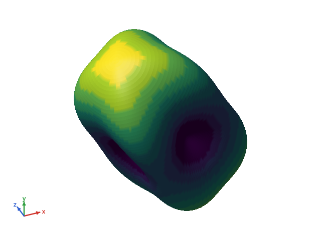
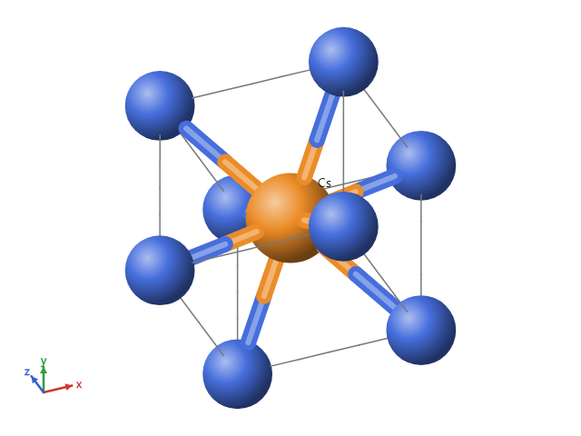
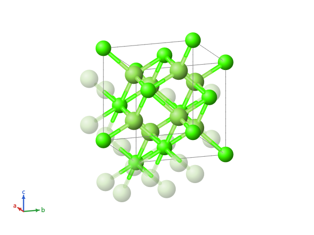
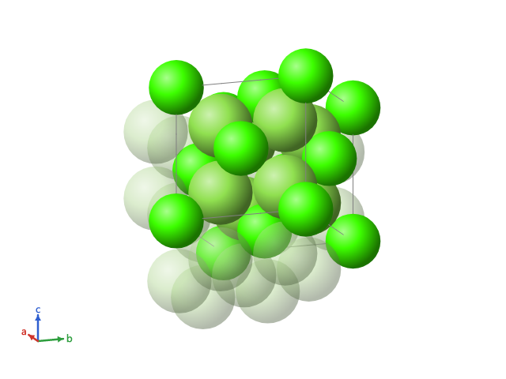
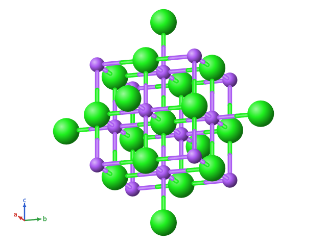
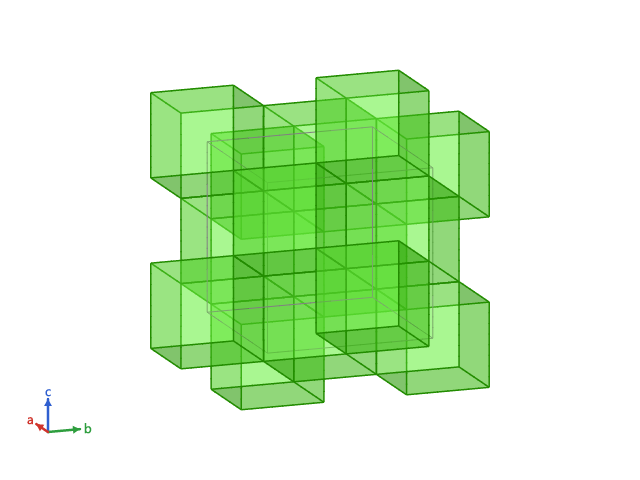

# Viewer3D

A small 3D viewer for [Avalonia](https://avaloniaui.net/) 12, painted by software through SkiaSharp. It shows
surfaces (closed spherical surfaces and height fields) and ball-and-stick scenes, with orbit, zoom and pan, a fixed
axis indicator, picking, and off-screen export to PNG.

It does not use OpenGL or any GPU API: frames are prepared on the CPU and painted as Skia triangles, circles and
lines. It looks and behaves the same with GPU or software rendering, and in `Avalonia.Headless`, which makes it easy
to test.

| Spherical surface | Balls and sticks |
|---|---|
|  |  |

## Packages

| Package | What it has |
|---|---|
| `Viewer3D` | Scene, camera, frame preparation, picking, axis indicator, color maps and surface builders. No UI and no graphics library: only `System.Numerics`. |
| `Viewer3D.Avalonia` | The `Viewer3DControl` for Avalonia 12, painted with SkiaSharp. |
| `Viewer3D.Crystal` | Optional crystal layer: a crystal structure turned into a scene, in ball and stick or space filling. References only `Viewer3D`. |

## Quick start

```csharp
using System.Numerics;
using Viewer3D;
using Viewer3D.Avalonia;

// A surface r(theta, phi) on a grid of N + 1 rows: one value at each pole, 2N values in between.
int n = 90;
double[][] radii = /* your grid */;
var map = new LevelColorMap(levels, colors);           // or new FuncColorMap(v => ...)
// The key light, from the upper left, shows the relief; the default light, at the eye, is flatter.
MeshItem surface = SurfaceBuilder.Spherical(radii, n, map: map, lighting: MeshLighting.KeyLight);

var viewer = new Viewer3DControl
{
    Scene = new Scene([surface]),
    // Optional: a lighter scene painted while the user drags or zooms.
    LowDetailScene = new Scene([SurfaceBuilder.Spherical(SurfaceBuilder.Decimate(radii, n, 3), n / 3, map: map, lighting: MeshLighting.KeyLight)]),
    AxisDirections = [new(Vector3.UnitX, "a"), new(Vector3.UnitY, "b"), new(Vector3.UnitZ, "c")],
};
viewer.Camera!.Frame(viewer.Scene);

byte[] png = viewer.RenderToPng(1600, 1200);
```

Scenes are lists of items: `MeshItem` (triangles with a color per vertex or per face), `SphereItem`, `RodItem` (a
stick drawn in two halves, each with the color of its end, cut where it enters the spheres), `LineItem` and
`LabelItem`. Each item has an `Id`, which picking reports back. A mesh is lit by a light at the eye
(`MeshLighting.Headlight`, the default) or by a key light from the upper left of the screen with a small highlight
(`MeshLighting.KeyLight`), which shows the relief of a surface seen head on; a weak fill light and a high ambient keep
the colors of the darker side.

## Interaction

| Gesture | Effect |
|---|---|
| Drag | Rotate |
| Right drag, or Shift and drag | Move |
| Wheel | Zoom at the pointer |
| Double click | Frame the scene |
| Arrow keys, `+` and `-` | Rotate and zoom |

The `Camera` raises `Changed` on every change, so two viewers that share one camera instance move together.
`ItemHovered` reports what is under the pointer, with the triangle and barycentric weights for meshes. `ItemClicked`
reports what was clicked (or the background) on a left click that did not turn into a drag.

A `SphereItem` with `Sectors` is painted as wedges from twelve o'clock, clockwise, each in its own color; what the
fractions leave of the turn stays empty, with the outline of the disc.

## Crystal layer

`Viewer3D.Crystal` builds the scene of a crystal structure. The layer is optional: `Viewer3D.Avalonia` does not
reference it.

| Ball and stick | Space filling |
|---|---|
|  |  |

```csharp
using Viewer3D.Crystal;

var cell = new CrystalCell(5.463, 5.463, 5.463, 90, 90, 90);       // angstrom and degrees
CrystalAtom[] atoms = [new("Ca1", "Ca", 0, 0, 0) { SiteIndex = 0 }, /* every position, one by one */];
CrystalBond[] bonds = [new(0, 4, LatticeShift.Zero), /* second atom translated by the shift */];
var structure = new CrystalStructure(cell, atoms, bonds);
// Bonds given around one atom per site are extended to the other atoms of the site.
structure = structure with { Bonds = CrystalBondExpansion.ExtendToEquivalentAtoms(structure) };

CrystalScene scene = new CrystalSceneBuilder().Build(structure, new CrystalSceneOptions
{
    Style = CrystalStyle.BallAndStick,          // or CrystalStyle.SpaceFilling
    RepeatA = 2, RepeatB = 2, RepeatC = 1,      // 1 to 3 cells along each axis
});
viewer.Scene = scene.Scene;
viewer.AxisDirections = scene.Axes;              // a, b and c, in the viewer's axis colors
CrystalItemInfo? info = scene.Lookup(pickedId);  // which atom or bond a sphere or rod stands for
```

- **Model.** A `CrystalCell` (edges in angstrom, angles in degrees), the atoms at fractional coordinates, each
  position listed (the layer does not apply symmetry), and the bonds as pairs of atom indices with a cell
  translation. An atom can carry its own radius, the elements sharing its position (`Shares`) and its occupancy; a
  shared or partly occupied position is painted in sectors.
- **Frame.** a along x, b in the xy plane, c on the side of +z, in angstrom.
- **Block.** Positions are reduced to the cell; `ShowBoundaryAtoms` adds the atoms on the far faces of the block,
  and `CompleteCoordination` draws the bonded neighbors outside it as faded spheres. The cell edges are drawn once
  each; the axes go to the axis indicator only. A block past 3000 spheres falls back to one cell, with a `Warning`.
- **Styles.** Ball and stick draws each sphere at `BallScale` times the atom radius, with rods. Space filling has no
  rods and multiplies every radius by s = min over the bonds of d / (r1 + r2), so the closest bonded pair touches
  and no bonded pair overlaps; without bonds, s comes from the shortest distance in one cell.
- **Polyhedra.** `CrystalStructure.Polyhedra` holds coordination polyhedra computed by the owner (a center, its
  vertices as atoms with a cell translation, and the faces counter-clockwise seen from outside; the layer does not
  compute hulls). The `Polyhedra` style (ball and stick) and `PolyhedraWithEllipsoids` (thermal ellipsoids) draw each
  one around every drawn image of its center as a translucent mesh (`PolyhedronOpacity`) with its edges; a vertex
  outside the block is a faded sphere. `ShowPolyhedronVertices`, `ShowBondsInsidePolyhedra`, `PolyhedronBackFaces`
  and `EnabledPolyhedra` choose what is drawn. Faces are ordered back to front per triangle, which is right for convex
  polyhedra that only share vertices, edges or faces. Against the 3000 ceiling a polyhedron counts as 8 spheres.
  Run `Viewer3D.Sample --bench-polyhedra N` in Release to time N octahedra.
- **Bond length.** A bond is automatic (`IsAutomatic`, the owner's own criterion) or a candidate that only a length
  limit draws. `CrystalSceneOptions.MaxBondLength`, and `AtomStyle.MaxBondLength` per element, site or atom over it,
  set the longest bond each atom lets through (0: none); a bond is drawn when both of its atoms let it through, and
  with no limit only the automatic ones are. The layer finds no bond itself: the candidates come from the owner. A
  polyhedron is drawn only when its center-vertex pairs pass.
- **Elements.** `ElementTable` has color and radius for Z 1 to 118: the Jmol colors as published by
  [pymatgen](https://github.com/materialsproject/pymatgen) (MIT), the metallic radius of pymatgen for metals and the
  covalent radius of Cordero et al. (Dalton Trans., 2008, 2832) for the other elements. Values without a reference
  (covalent radii past Z 96, colors the Jmol scheme does not list) are estimates, marked `IsEstimated`.
  `CrystalSceneOptions.ElementColors` overrides the colors.

### Sphere around a point

`Clip = CrystalClip.Sphere` shows every atom image within `SphereRadius` angstrom of `SphereCenter` (fractional
coordinates), whatever cell it falls in, instead of a block of cells. A bond is drawn only when both of its atoms are
inside, and there are no cell edges; a polyhedron around a center inside is drawn whole, with its outside vertices
faded. A sphere past 3000 spheres falls back to one cell, with a `Warning`.

```csharp
CrystalScene scene = new CrystalSceneBuilder().Build(structure, new CrystalSceneOptions
{
    Clip = CrystalClip.Sphere,
    SphereCenter = new FractionalPoint(0.5, 0.5, 0.5),   // a Cl of rock salt
    SphereRadius = 6,                                     // angstrom: the Cl and its first four shells
});
```



### Appearance

`CrystalSceneBuilder.Build(structure, options, appearance)` takes a `CrystalAppearance`, an immutable set of look
rules. Each field of a style is nullable, and the most specific level that sets it wins:

| Cascade | Levels, from general to specific | Fields |
|---|---|---|
| Atoms | `AtomDefault`, `ByElement`, `BySite`, `ByAtom`, `ByImage` | visible, color, opacity, radius scale, label, label text |
| Bonds | `BondDefault`, `ByElementPair`, `ByBond` | visible, color, opacity, radius |
| Polyhedra | `PolyhedronDefault`, `PolyhedronByElement`, `PolyhedronBySite`, `ByPolyhedron` | visible, face color and opacity, faces, edges, edge color and width |

`ShowAtoms`, `ShowBonds`, `ShowCell` and `ShowPolyhedronCenters` switch whole groups off; `ColorScheme` colors the
atoms by element, site or occupancy (the last two with `CrystalScene.ColorLegend`). A hidden atom takes its label and
its rods with it; the polyhedra it belongs to stay whole. `CrystalScene.HiddenAtomCount` counts the hidden atoms of
the block, and `ShowAll()` makes everything visible again and keeps the colors. `RemovedBonds` leaves bonds out by
their `CrystalBond.SourceIndex`, every image and its faded neighbor with them, and `ShowAll()` keeps them; after
`CrystalBondExpansion`, remove the whole `CrystalBondExpansion.EquivalentSources` of a bond, since its images carry
the source of whichever equivalent bond came first. Without an appearance, or with
`CrystalAppearance.Default`, the builder gives the same scene as before.



`Viewer3DControl.SelectedItemIds` rings several items at once, `ItemClicked` carries the modifier keys (Ctrl+click
to add to a selection), `HoveredPick` tells what is under the pointer (for a context menu), `SceneBackground` sets
the background over the theme (alpha 0 for a transparent PNG) and `OutlineWidth` the outline of spheres and ellipses.
Run `Viewer3D.Sample --bench-appearance N` in Release to time the build with and without rules.

## Theme colors

The control reads these resources (a `Color` or a solid brush), with built-in light and dark defaults:
`Viewer3DBackgroundColor`, `Viewer3DLabelColor`, `Viewer3DSelectionColor` (the selection ring; the label color without
it), `Viewer3DAxisColor0`, `Viewer3DAxisColor1` and `Viewer3DAxisColor2`.

## Performance

Measured on a desktop CPU with software rendering: a spherical surface of N = 90 (32 040 triangles) turns at about
40 to 50 frames per second; N = 360 (516 960 triangles) at about 7. Give `LowDetailScene` a coarser surface and the
viewer paints it during gestures and the full one when the gesture ends.

## Building

```
dotnet test Viewer3D.sln -c Release
dotnet run --project samples/Viewer3D.Sample
```

`samples/Viewer3D.Sample --export <dir>` writes the four images above.

## License

[MIT](LICENSE).
